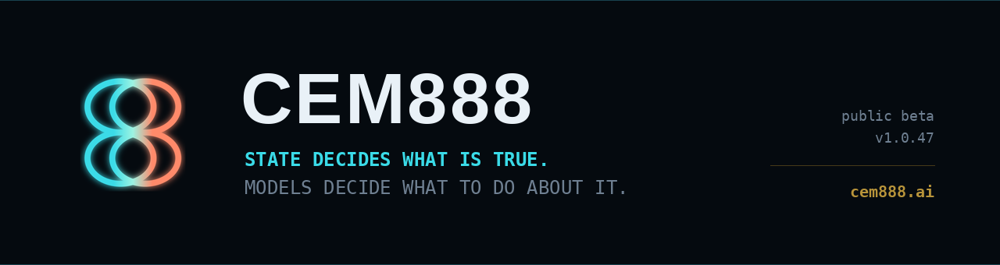
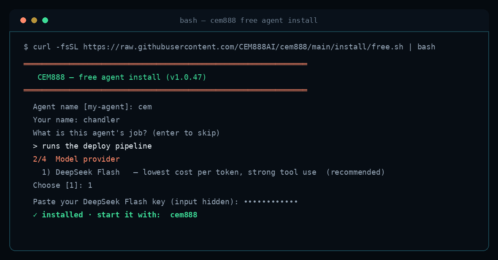

<div align="center">



<br/>

<a href="#install-the-free-agent">
  
</a>
&nbsp;
<a href="https://cem888.ai">
  
</a>
&nbsp;
<a href="#documentation-map">
  
</a>

<br/>

[](https://github.com/CEM888AI/cem888/releases)
[](./LICENSE)
[](./docs/STATUS.md)
[](./docs/PUBLIC_CONFORMANCE.md)
[](https://github.com/CEM888AI/benchmarks)

<br/>


</div>

---

## Install the free agent

One command. No account, no signup. The free lane is the **agent itself** — terminal chat, or
connect it to Telegram. There is no desktop app in it.

<p align="center">
  
</p>

**macOS and Linux**

```bash
curl -fsSL https://raw.githubusercontent.com/CEM888AI/cem888/main/install/free.sh | bash
```

**Windows** — PowerShell, Windows 10 1803 or newer (x86_64)

```powershell
irm https://raw.githubusercontent.com/CEM888AI/cem888/main/install/free.ps1 | iex
```

It asks five things — **agent name**, **your name**, the **agent's job** (or enter to skip), a
**provider**, and your **API key**. Then it installs and tells you how to start it.

**Cheapest first, on purpose:** DeepSeek Flash · GLM Flash · GPT Luna — plus OpenAI · Anthropic ·
OpenRouter · any OpenAI-compatible endpoint. Bring your own key; nothing is proxied through us.

Deep reasoning later, without reinstalling:

```bash
cem888 model        # switch the default provider/model
cem888 fallback     # a strong model behind the cheap one, only reached when needed
```

macOS (Apple silicon and Intel), Linux x86_64 and Windows x86_64. Windows **arm64** is not in this
release: the published wheel set is `windows-amd64`, and shipping a script that cannot find its own
wheels is worse than saying so.

**[What the installer does, what it downloads, and why the checks are shaped that way](./install/README.md)**

---

<table>
<tr>
<td align="center" width="33%"><b>Agent, not a chat box</b><br/><sub>Terminal chat, or your own Telegram bot. The free lane has no desktop app.</sub></td>
<td align="center" width="33%"><b>Your key, your machine</b><br/><sub>Bring your own model access. State stays on your machine, not on a shared service.</sub></td>
<td align="center" width="33%"><b>Nothing to sign up for</b><br/><sub>One command, five questions, no account. Switch models later without reinstalling.</sub></td>
</tr>
</table>

<div align="center">
  
</div>

## The failure this exists for

Every agent framework optimizes **what the agent does next**. Almost nothing decides **what is actually true**. Those are different problems, and the second one is where agents fail in production:

- **State drifts.** The session ends, the transcript gets summarized, and last week's decision comes back as if it were current.
- **Stale truth wins.** An old fact is still retrievable, so relevance resurrects it and the agent acts on a superseded decision.
- **Retries duplicate.** A step runs twice because nothing outside the model recorded that it already ran.
- **"Done" is prose.** The model says it finished. No postcondition was checked, no evidence was captured, no receipt exists.

CEM888 puts the four things an agent needs outside the model:

| Question | Where the answer lives |
| --- | --- |
| **What is true now?** | Authoritative current state. Newer state supersedes older; history is kept. Relevance retrieves a candidate — it never raises its authority. |
| **What does this model need now?** | A context packet compiled per turn, instead of replaying a growing transcript. |
| **What is this agent allowed to do?** | Models propose. Runtime state and scope decide what crosses an execution boundary. |
| **What actually happened?** | Where a postcondition is observable, the runtime checks evidence and writes a receipt instead of trusting prose. |

```text
EXISTING AGENT / HOST
        |
        v
CEM888 STATE + CONTROL RUNTIME
  - identity + scope
  - authoritative current state
  - continuity / recovery
  - bounded working context
  - action authority
  - verification + receipts
        |
        v
EXISTING MODELS / TOOLS / DATA
```

## See the artifacts, not the marketing

The point of a runtime is what it emits. These are **sanitized samples of real structures** — field names and shapes are what the runtime actually produces, values are redacted:

- **[`examples/context-packet.json`](./examples/context-packet.json)** — what one turn is actually given: identity without scoring, owner rulings, current checkpoints, agreement state.
- **[`examples/receipt.json`](./examples/receipt.json)** — a verified action: what was proposed, what was checked, what evidence satisfied the postcondition.
- **[`examples/blocked-action.json`](./examples/blocked-action.json)** — an action denied at the boundary, and the rule that denied it.

No implementation detail is exposed by any of them. That is deliberate — see [Repository scope](#repository-scope).

## Evidence scorecard

Every result links to its source. **Failures are published next to passes**, because a scorecard that can't fail proves nothing:

| Check | Result | Scope | Source |
| --- | --- | --- | --- |
| Public conformance suite | **15 / 15 pass** | Tier-0 authority manifest loading (fail-closed) + layer classification, superseded-state exclusion, supersession lifecycle, context-receipt provenance | [PUBLIC_CONFORMANCE.md](./docs/PUBLIC_CONFORMANCE.md) |
| Independent runtime evaluation (2026-09-18) | **9 / 9 pass** | Durable state, kill-and-recover, model swap, verified execution, authority boundary, unknown state, provenance, contradiction/freshness, failure recovery | [Hugging Face dataset](https://huggingface.co/datasets/CEM888AI/cem888-independent-runtime-evaluation) |
| Fresh-install acceptance (2026-10-01) | **Core first-boot / continuity path passed — with documented defects** | Durable state, automatic exhale, two fresh-process restarts, explicit supersession, live retrieval/index surfaces, evidence-verified file action, retry deduplication | [FRESH_INSTALL_ACCEPTANCE_2026-10-01.md](./docs/FRESH_INSTALL_ACCEPTANCE_2026-10-01.md) |
| Claude Code host observation (2026-10-03) | **Turn-level continuity changed live engineering behavior** | Project state + repo/deploy/install constraints arrived automatically; owner prohibition blocked a protected edit; Claude used injected context while diagnosing a Codex connector profile conflict | [case study](https://github.com/CEM888AI/runtime-case-studies/blob/main/case-study-claude-code-turn-level-continuity.md) |
| Earlier installed customer artifact | **2 PASS / 9 FAIL — NON-CONFORMANT** | Historical install-conformance baseline, retained deliberately to show the harness can reject a build | [STATUS.md](./docs/STATUS.md#published-non-conformant-baseline) |
| Engineering runtime falsifiers | 8 authority · 53 verification · 17 hook-sync · 4 fabricated-evidence · 4 store-locking — all pass | CEM engineering runtime, not yet the customer artifact | [current-engineering-status.md](https://github.com/CEM888AI/runtime-case-studies/blob/main/current-engineering-status.md) |

The runtime evaluation was run by an AI engineering assistant on Hugging Face Jobs infrastructure on September 18, 2026 (Debian 13, DeepSeek, CEM888 v1.0.x). Method and terms are on the dataset page.

**Benchmark of record:** BEAM-10M **77.2%** (154.4 / 200), live agent, no answer-key access. Per-question data, scoring script and methodology: **[CEM888AI/benchmarks](https://github.com/CEM888AI/benchmarks)**. Other runs in that repository are labeled experimental or measure a different benchmark, and are not substitutes for this number.

## How it fits

CEM888 attaches at lifecycle seams. It does not replace a partner's agent architecture:

```text
TURN START                 resolve identity / task -> load current state -> compile bounded context
BEFORE CONSEQUENTIAL ACTION resolve target / scope -> authorize or block where an enforceable boundary exists
AFTER EXECUTION            capture observable evidence -> evaluate the postcondition
TURN FINISH                commit resulting state -> record checkpoint / receipt
```

A partner keeps its UI, planner, model choice, tools, domain workflow and observability stack. MCP connectivity alone is not a claim of full control — each host is classified by the lifecycle boundaries it actually exposes. See **[Integration contract](./docs/INTEGRATION.md)**, **[Enforcement matrix](./docs/ENFORCEMENT_MATRIX.md)** and **[Native host adapters](./docs/HOST_ADAPTERS.md)**.

### What this is not

| What you already run | What it decides | What CEM888 adds |
| --- | --- | --- |
| Agent frameworks — LangGraph, CrewAI, AutoGen, OpenAI Agents SDK | Which step runs next, and how work is orchestrated | Those stay. CEM888 decides what state the steps are allowed to believe. |
| Memory layers — mem0, Letta, Zep | What to remember and retrieve | Retrieval finds a candidate. CEM888 decides whether it is still *current* and how much authority it carries. |
| Observability and evals — LangSmith, Braintrust, W&B | What happened, after the fact, in traces | CEM888 checks postconditions *before* the agent may claim completion, and writes a receipt at the boundary. |
| Guardrail / policy proxies | Whether a call is textually allowed | Scope and authority are resolved per turn against current state, and denials are recorded, not just logged. |

These compose with CEM888. Nothing here requires replacing the stack you already have.

## FAQ

**Is this an agent framework?** No. It is a runtime underneath one. You keep your planner, model and tools.

**Do I have to rewrite my agent?** No. You integrate at up to four seams (turn start, before a consequential action, after execution, turn finish). Partial integration is supported and classified honestly — the [enforcement matrix](./docs/ENFORCEMENT_MATRIX.md) states what each host can and cannot block.

**Does my data leave my machine?** No. Customer agents run on the customer's machine or customer-controlled infrastructure, not on a shared CEM888 execution service. Model access is bring-your-own-key.

**Can I install from this repository?** The **free agent** installs from this repository with the one command above — that is the whole point of it. The **engine source** is not published here. Paid tiers, native-host adapters and the desktop app go through **[cem888.ai](https://cem888.ai)**: create an account, configure the agent, download the installer for your machine.

**Why isn't the source here?** Publishing the engine hands over the business without handing over a customer. The published record — architecture, enforcement limits, acceptance runs including the failures, and reproducible benchmark data — is the proof. It is not a substitute for reading the code, and this README does not pretend it is.

**What is actually certified today?** DeepSeek Flash-first first-boot/continuity passed on 2026-10-01 **with documented defects**; the Claude Code adapter has live host observation; the Codex connector is **not** certified. [Status](./docs/STATUS.md) is the single source of truth, and it is updated when things fail, not only when they pass.

**Is the benchmark self-reported?** It is a live agent run with per-question data and the scoring script published in [benchmarks](https://github.com/CEM888AI/benchmarks), plus an independent runtime evaluation published as a dataset. Judge it on the artifacts, not the number.

## Current stage

Public beta. The release lane is deliberately narrow: **finish and certify the free first-boot path, then expand provider and native-host support from measured evidence.**

| Surface | Current status |
| --- | --- |
| **CEM engineering runtime** | Operating and used to prove product-relevant mechanisms. It is not the website customer artifact. |
| **Customer product artifact** | DeepSeek Flash-first fresh-install continuity path passed on 2026-10-01 with documented defects; fixes and a frozen-artifact rerun are still required before full certification. |
| **Free agent installer (macOS / Linux)** | Shipped and live: provider-neutral, five prompts, bring-your-own-key. |
| **Free agent installer (Windows)** | Shipped as `install/free.ps1` for x86_64 with the same five prompts. Not yet accepted on real hardware — the first acceptance run is pending, and this line changes when it passes or fails. |
| **Claude Code native adapter** | Live turn-level continuity exercised 2026-10-03; host observation published. Packaging and certification remain separate from the frozen DeepSeek customer artifact. |
| **Codex native adapter** | Connector exists; live diagnosis found contradictory profile guards preventing successful turns. Fix and certification still required. |
| **High-consequence / regulated deployments** | Product direction; compliance scoped per deployment. |

The customer artifact is a **promotion and certification target**, not assumed correct because a mechanism exists elsewhere. Full table: **[Technical Status](./docs/STATUS.md)**.

## Claim discipline

CEM888 separates **implemented**, **customer-certified**, **specified** and **planned** behavior. For example, the dual owner-prohibition model — prohibited material is never promoted as current truth, and matching protected actions are blocked at an enforceable boundary — is part of the public contract, but it is **not represented as customer-certified until both falsifiers pass on the exact installed artifact.**

## Local-first and customer control

The website is the account, onboarding and download surface. Customer agents run on the customer's machine or customer-controlled infrastructure, not on a shared CEM888 execution service. Clean installs start with clean identity, state, authority, configuration and credentials. Model access is bring-your-own-key.

## Repository scope

This repository is the **public engineering record** for the CEM888 runtime — architecture, honest status, the free agent installer, and the evidence behind every claim. It is not the production-development authority.

**What is deliberately not here:** the runtime source, the agent system prompt and prompt stack, the action-authority implementation, the memory and indexing implementation, provider routing, the context/breathing cycle, credentials and auth internals, customer data and state, and per-file provenance. Those are proprietary; publishing them would hand over the engine without handing over the business. Third-party notices are preserved in **[licenses/third-party/MIT-NOTICE.txt](./licenses/third-party/MIT-NOTICE.txt)**.

### Documentation map

| Document | What it answers |
| --- | --- |
| [ARCHITECTURE.md](./docs/ARCHITECTURE.md) | How state, context compilation, authority and receipts work |
| [CAPABILITY_MATRIX.md](./docs/CAPABILITY_MATRIX.md) | What is implemented, certified, specified or planned |
| [ENFORCEMENT_MATRIX.md](./docs/ENFORCEMENT_MATRIX.md) | What can actually be blocked, per host, and what cannot |
| [HOST_ADAPTERS.md](./docs/HOST_ADAPTERS.md) | Claude Code, Codex, Cursor, Copilot — what each exposes |
| [INTEGRATION.md](./docs/INTEGRATION.md) · [INTEGRATION_RECIPES.md](./docs/INTEGRATION_RECIPES.md) | The contract, and worked recipes |
| [PUBLIC_CONFORMANCE.md](./docs/PUBLIC_CONFORMANCE.md) | The 15-check suite and how to read it |
| [STATUS.md](./docs/STATUS.md) | What is certified right now, including known defects |
| [FRESH_INSTALL_ACCEPTANCE_2026-10-01.md](./docs/FRESH_INSTALL_ACCEPTANCE_2026-10-01.md) | A full acceptance run, written up as it happened |
| [install/README.md](./install/README.md) | What the free installer does, and why it is shaped that way |

## License

**The published record in this repository** — documentation, matrices, case-study text — is licensed under the **[CEM888 Source-Available Commercial License](./LICENSE)**: read it, audit it, cite it, quote it, fork it for personal non-commercial use. It **never converts** to an open-source licence.

**The runtime itself** is proprietary software distributed under that same licence: broad rights to use what you install, **free for personal, non-commercial use**, with commercial deployment, paid client work, embedding, resale, white-labeling, OEM distribution and hosted service requiring a valid CEM888 licence key for the applicable tier or a separate commercial licence from **CEM Unlimited LLC**.

| You want to… | Without a paid licence |
| --- | --- |
| Read, evaluate, test, or develop against the published record | Yes — no licence needed |
| Run CEM888 in production for yourself, personally | Yes — Free tier, personal and non-commercial |
| Use it in business production, or in paid client/consulting work | **No** — requires a licence key or commercial licence |
| Embed, resell, white-label, or OEM-distribute it | **No** — separate commercial licence |
| Provide it to third parties as a hosted or managed service | **No** — prohibited |
| Move, change, disable, or circumvent the licence-key functionality | **No** — prohibited |

**Release history — licensing changes are prospective and never retroactive.** CEM888 v1.0.3 remains under the **AGPL-3.0** terms that accompanied that release; versions first released under **Business Source License 1.1** remain under those BSL terms; versions released under the **Elastic License 2.0** remain under those terms. Current and future versions use the **[CEM888 Source-Available Commercial License](./LICENSE)**.

## Contributing · Security · Releases

Outside contributions require the **[Contributor License Agreement](./CLA.md)** before merge — see **[CONTRIBUTING.md](./CONTRIBUTING.md)**. Report vulnerabilities privately to **creator@cem888.ai**; scope and response targets in **[SECURITY.md](./SECURITY.md)**. Tagged releases with notes: **[Releases](https://github.com/CEM888AI/cem888/releases)** · **[CHANGELOG.md](./CHANGELOG.md)**.

## Enterprise direction

CEM888 is intended to mature into a reliability, continuity and control layer for AI in data-sensitive and high-consequence environments, including legal, financial, public-sector and regulated enterprise systems. That requires customer-controlled deployment, identity isolation, provenance, explicit authority, evidence-backed verification, restart/recovery continuity and clear trust boundaries. Sector-specific compliance is scoped with each customer, per deployment.

---

<div align="center">

**If this is the layer you've been missing, a star is how the next engineer finds it.**

Built and maintained by **Chandler Morone / CEM Unlimited LLC** · **[cem888.ai](https://cem888.ai)** · creator@cem888.ai

</div>
